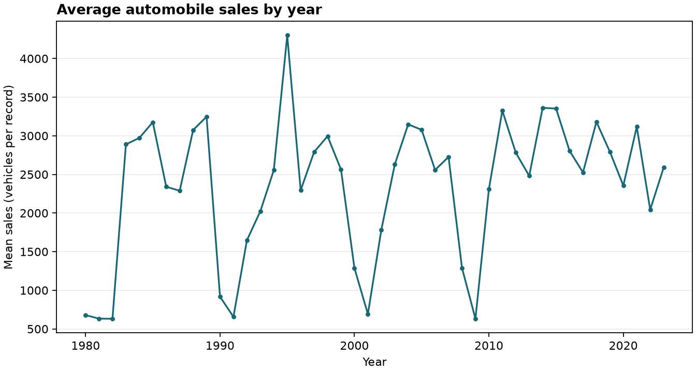
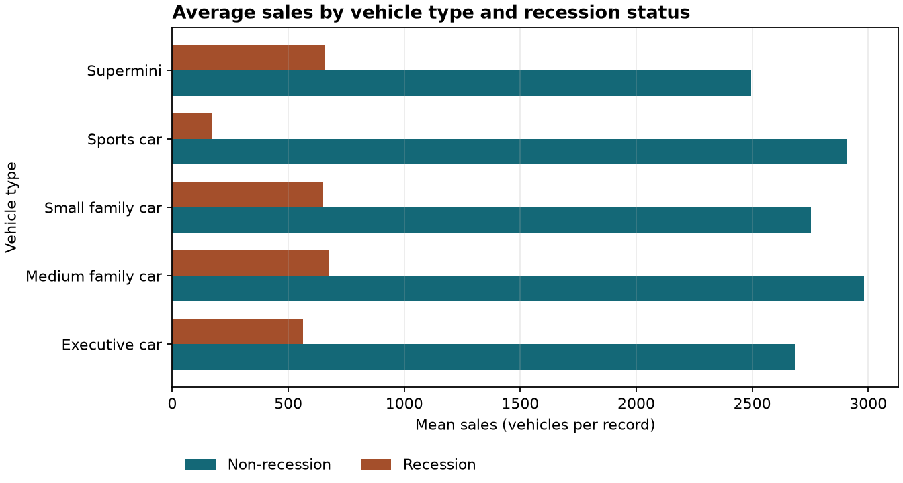

# Assignment 02 · Automobile Sales During Recessions

This portfolio write-up reproduces selected CISC7204 Assignment 02 analyses. I compared average automobile sales over time and by vehicle type across recession and non-recession observations.

The [IBM Skills Network historical automobile-sales dataset](https://cf-courses-data.s3.us.cloud-object-storage.appdomain.cloud/IBMDeveloperSkillsNetwork-DV0101EN-SkillsNetwork/Data%20Files/historical_automobile_sales.csv) contains 528 records spanning 1980–2023. The submitted notebook used a 528-record reference copy. The fields used here and the resulting comparisons match the provider file. The source is available for download. Redistribution terms were not confirmed, so the repository contains an independent analysis script, aggregate charts and this write-up.

## Findings

Average sales were **648.52 vehicles per record** during recession periods (113 records) and **2,816.75** outside recession periods (415 records). The peak annual mean in this dataset was 4,300.25 vehicles per record in 1995. Average sports-car sales were 170.33 during recessions and 2,910.64 outside recessions.

These are means of the course dataset records. The vehicle mix, time periods and number of observations differ across groups. The comparisons do not isolate the effect of recession status. This showcase covers the time and vehicle-type comparisons from the assignment.

## Reproduce

Use Python 3.12 and run `python -m pip install -r requirements.txt`, then `python analysis.py`. The script reads the provider CSV directly. To reproduce against the same reference copy used in the submitted notebook, run `python analysis.py --input /path/to/automobile-sales-reference-528.csv`.
